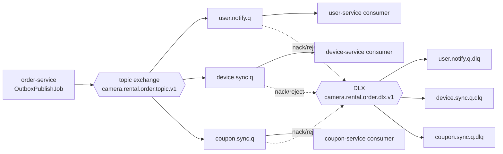
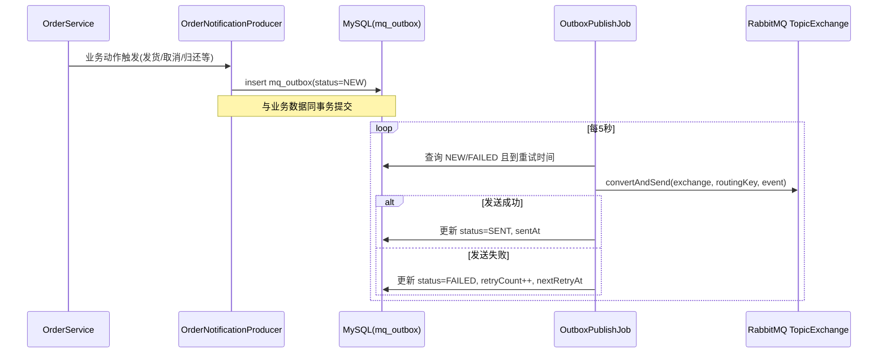
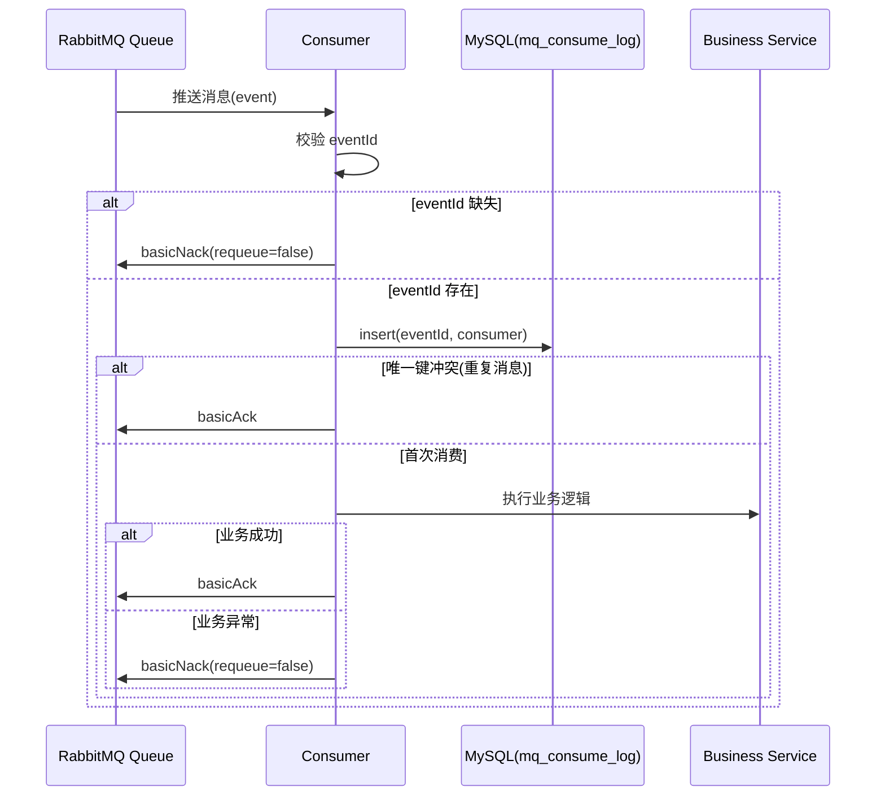

# Camera Rental 项目消息队列流程详解

> 文档目标：系统化说明本项目 RabbitMQ 链路如何工作，以及如何排查消息异常。
> 
> 适用范围：`service/` 下各 Java 微服务（尤其是 `order-service`、`user-service`、`device-service`、`coupon-service`）。
> 
> 更新时间：2026-04-15

---

## 1. 总览

当前项目采用了以下消息驱动模式：

1. 事件源头在 `order-service`。
2. 生产端采用 Outbox 模式（先落库，再异步投递 MQ）。
3. 消费端采用手动 ACK + 幂等日志表去重。
4. 失败消息通过 DLX 路由到对应 DLQ，避免主队列阻塞。

这个组合实现的是“至少一次投递 + 消费幂等”，属于工程上较稳妥的最终一致性方案。

---

## 2. 核心组件与职责

### 2.1 交换机与队列常量

- 常量定义文件：`service/camera-rental-common/src/main/java/com/example/camerarental/common/mq/MqConstants.java`
- 主要资源：
  - 主题交换机：`camera.rental.order.topic.v1`
  - 死信交换机：`camera.rental.order.dlx.v1`
  - 用户通知队列：`camera.rental.user.notify.q`
  - 库存补偿队列：`camera.rental.device.sync.q`
  - 优惠券补偿队列：`camera.rental.coupon.sync.q`
  - 各自 DLQ：`*.dlq`

### 2.2 生产端（订单服务）

- Outbox 生产器：`service/camera-rental-order-service/src/main/java/com/example/camerarental/order/mq/OrderNotificationProducer.java`
- Outbox 发布任务：`service/camera-rental-order-service/src/main/java/com/example/camerarental/order/job/OutboxPublishJob.java`
- Rabbit 回调监控：`service/camera-rental-order-service/src/main/java/com/example/camerarental/order/mq/RabbitProducerCallbackConfig.java`

### 2.3 消费端

- 用户通知消费：`service/camera-rental-user-service/src/main/java/com/example/camerarental/user/mq/OrderNotificationConsumer.java`
- 库存补偿消费：`service/camera-rental-device-service/src/main/java/com/example/camerarental/device/mq/OrderCancelledReleaseStockConsumer.java`
- 优惠券补偿消费：`service/camera-rental-coupon-service/src/main/java/com/example/camerarental/coupon/mq/OrderCancelledRollbackCouponConsumer.java`

### 2.4 配置来源

- RabbitMQ 共享配置：`nacos_config/SHARED_GROUP/rabbitmq-config.yaml`
- 关键配置项包括：
  - `publisher-confirm-type: correlated`
  - `publisher-returns: true`
  - `template.mandatory: true`
  - `listener.simple.acknowledge-mode: manual`

---

## 3. 拓扑关系

---

## 4. 事件与路由键设计

### 4.1 通知类事件（用户消息）

- 路由模式：`order.*.notify.user`
- 典型路由键：
  - `order.shipped.notify.user`
  - `order.received.notify.user`
  - `order.return.applied.notify.user`
  - `order.return.confirmed.notify.user`

### 4.2 取消订单补偿类事件

- `order.cancelled.release.stock`：释放库存
- `order.cancelled.rollback.coupon`：回滚优惠券

---

## 5. 生产链路详细时序（Outbox 模式）

### 5.1 为什么不用“业务里直接发 MQ”

直接发 MQ 会有经典一致性窗口问题：

- 数据库事务成功但 MQ 发失败。
- MQ 发成功但数据库事务回滚。

Outbox 的价值是把“待发消息”先纳入数据库事务，后续异步补偿发送，降低丢消息风险。

### 5.2 Outbox 状态机

- `NEW`：新建待投递
- `SENT`：投递成功
- `FAILED`：投递失败，等待重试

`OutboxPublishJob` 中采用指数退避并设置上限，避免频繁抖动重试打爆系统。

---

## 6. 消费链路详细时序（幂等 + 手动 ACK）

### 6.1 为什么是“至少一次 + 幂等”

RabbitMQ 在网络抖动、消费者重启、ACK 丢失时，可能重复投递同一消息。项目通过 `mq_consume_log` 的唯一键（`event_id + consumer`）将重复消息转化为幂等成功。

---

## 7. 取消订单场景完整链路

以“取消订单”为例，系统会并行发出两条补偿消息：

1. `order.cancelled.release.stock` -> `device-service`
2. `order.cancelled.rollback.coupon` -> `coupon-service`（仅当订单使用了优惠券）

处理效果：

1. 库存恢复。
2. 优惠券状态回滚。
3. 任一消费者失败时，消息进入对应 DLQ，便于后续人工或程序化补偿。

---

## 8. 死信队列（DLQ）机制

每个业务队列均声明了：

1. `x-dead-letter-exchange = camera.rental.order.dlx.v1`
2. `x-dead-letter-routing-key = xxx.dead`

当消费者执行 `basicNack(deliveryTag, false, false)` 时，不重回原队列，直接进入 DLQ。

适用场景：

1. 参数非法（例如 eventId 为空）。
2. 业务不可恢复异常。
3. 下游依赖异常导致持续失败。

---

## 9. 历史问题与当前状态

2026-04-15 曾出现过一次 AMQP 依赖缺失问题：`coupon-service`、`device-service` 未声明 `spring-boot-starter-amqp`，导致 `org.springframework.amqp.*` 与 `com.rabbitmq.client.Channel` 无法解析。

当前状态：

1. 该问题已修复，两个模块已补齐 AMQP 依赖。
2. `mvn -pl camera-rental-coupon-service,camera-rental-device-service -am compile -DskipTests` 已验证通过。
3. `CouponRabbitMqConfig`、`DeviceRabbitMqConfig`、对应消费者类均可正常编译。

建议：

1. 新增 MQ 消费者模块时，统一检查是否已引入 `spring-boot-starter-amqp`。
2. 每次依赖调整后执行分模块编译，优先在 CI 阶段提前暴露问题。

---

## 10. 运维排障清单

### 10.1 发布端排查

1. 查看 `mq_outbox` 是否存在大量 `FAILED`。
2. 查看 `retry_count`、`next_retry_at` 是否持续增长。
3. 检查 `RabbitProducerCallbackConfig` 日志中是否存在 `publish not acknowledged` 或 `returned message`。

### 10.2 消费端排查

1. 查看业务队列是否堆积。
2. 查看对应 DLQ 是否堆积。
3. 查看 `mq_consume_log` 是否持续写入。
4. 检查是否有大量重复事件（同 `event_id`）。

### 10.3 基础设施排查

1. RabbitMQ 连接参数是否与 Nacos 配置一致。
2. `virtual-host` 是否正确（默认 `/camera-rental`）。
3. 交换机、队列、绑定是否已成功声明。

---

## 11. 推荐监控指标

1. Outbox 未发送数量（`status in (NEW, FAILED)`）。
2. Outbox 发送成功率（SENT / 总发送尝试）。
3. 各业务队列与 DLQ 堆积深度。
4. 消费失败率（NACK 次数）。
5. 幂等命中率（重复消费次数）。

---

## 12. 一句话总结

本项目 MQ 方案本质是：

“订单服务通过 Outbox 保障发布可靠性，RabbitMQ 负责事件分发，消费端通过手动 ACK + DB 幂等日志保障最终一致性，异常消息统一流入 DLQ 做可观测补偿。”
