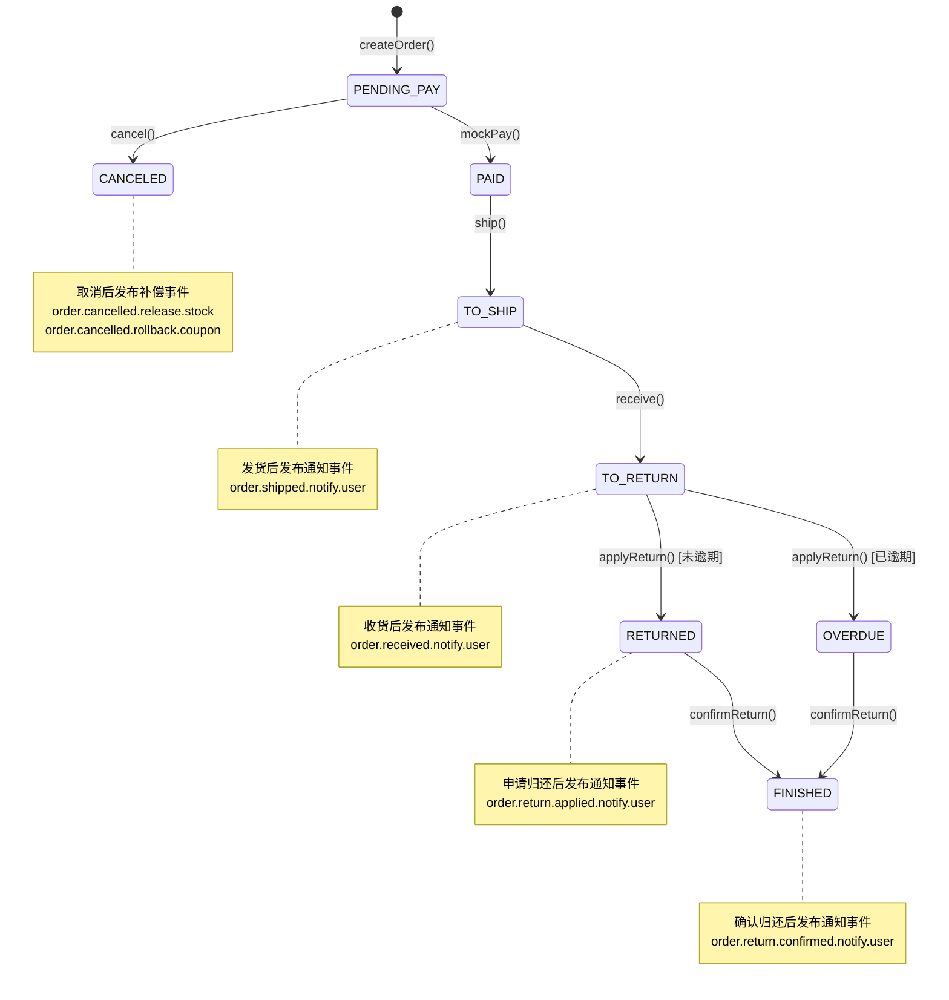
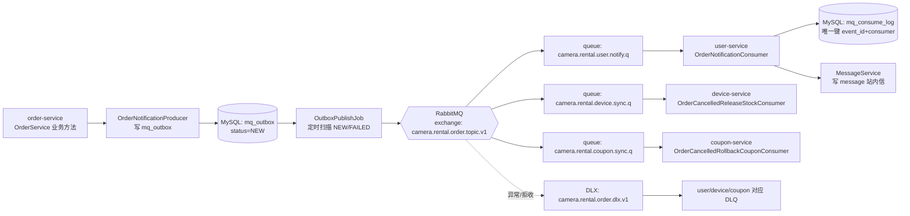

# 订单状态流转 + MQ 事件流转图

## 1) 订单状态流转（结合 `OrderService`）

## 2) 消息链路（Outbox + RabbitMQ + 幂等消费）

## 3) 路由键与业务动作映射

| 业务动作 | 触发方法 | 路由键 | 主要消费者 |
|---|---|---|---|
| 发货通知租客 | `ship()` | `order.shipped.notify.user` | `user-service` |
| 收货通知出租者 | `receive()` | `order.received.notify.user` | `user-service` |
| 申请归还通知出租者 | `applyReturn()` | `order.return.applied.notify.user` | `user-service` |
| 确认归还通知租客 | `confirmReturn()` | `order.return.confirmed.notify.user` | `user-service` |
| 取消后释放库存 | `cancel()` | `order.cancelled.release.stock` | `device-service` |
| 取消后回滚优惠券 | `cancel()` | `order.cancelled.rollback.coupon` | `coupon-service` |

## 4) 关键代码文件索引

- 订单状态与业务入口：`service/camera-rental-order-service/src/main/java/com/example/camerarental/order/service/OrderService.java`
- 消息常量：`service/camera-rental-common/src/main/java/com/example/camerarental/common/mq/MqConstants.java`
- 通知/补偿事件模型：`service/camera-rental-common/src/main/java/com/example/camerarental/common/mq/OrderNotificationEvent.java`、`service/camera-rental-common/src/main/java/com/example/camerarental/common/mq/OrderCancelledEvent.java`
- 生产端写 Outbox：`service/camera-rental-order-service/src/main/java/com/example/camerarental/order/mq/OrderNotificationProducer.java`
- Outbox 发布任务：`service/camera-rental-order-service/src/main/java/com/example/camerarental/order/job/OutboxPublishJob.java`
- RabbitMQ 声明：`service/camera-rental-order-service/src/main/java/com/example/camerarental/order/mq/OrderRabbitMqConfig.java`
- 消费端幂等+入站内信：`service/camera-rental-user-service/src/main/java/com/example/camerarental/user/mq/OrderNotificationConsumer.java`
- 消费幂等日志清理：`service/camera-rental-user-service/src/main/java/com/example/camerarental/user/job/MqConsumeLogCleanupJob.java`
- 数据库表定义：`sql/schema.sql`

